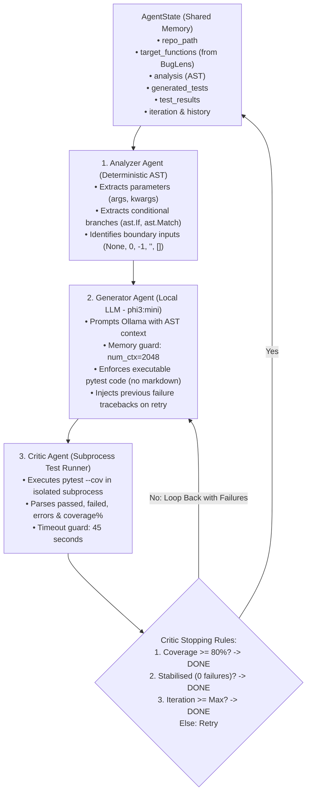

# CodeSentinel: Master Live Demonstration Runbook & Complete API Guide

> **AI-Powered Defect Prediction, Multi-Agent Targeted Test Generation & Closed-Loop Learning**  
> **B.E. Final Year Project 2026–2027 | Group 10**  
> **Department of Artificial Intelligence & Data Science**  
> **Fr. Conceicao Rodrigues College of Engineering (FR. CRCE), Bandra (W), Mumbai**  
> **Affiliated with the University of Mumbai**  
> **Project Team:** Atharva Nanaware (10511) · Suhera Siddiqui (10381) · Aum Singh (10383)

---

## Document Table of Contents
1. [Cold-Start Setup (Every Single Command From the Beginning)](#1-cold-start-setup-every-single-command-from-the-beginning)
2. [Complete REST API Demonstration Guide (All Endpoints)](#2-complete-rest-api-demonstration-guide-all-endpoints)
3. [Demonstration Across 3 Repositories (Flask, Requests, Movie Rec)](#3-demonstration-across-3-repositories-flask-requests-movie-rec)
4. [Deep-Dive Demonstration of the BugLens Module](#4-deep-dive-demonstration-of-the-buglens-module)
5. [Deep-Dive Demonstration of the AutoTestArmy Module](#5-deep-dive-demonstration-of-the-autotestarmy-module)
6. [Deep-Dive Demonstration of Closed-Loop Feedback & Retraining](#6-deep-dive-demonstration-of-closed-loop-feedback--retraining)
7. [Running the Full 30-Test Automated Regression Suite](#7-running-the-full-30-test-automated-regression-suite)
8. [Viva Presentation Script & Speaking Flow for Group 10](#8-viva-presentation-script--speaking-flow-for-group-10)

---

# 1. Cold-Start Setup (Every Single Command From the Beginning)

Follow these exact steps when starting on any computer from a fresh terminal.

### 1.1 Open PowerShell & Navigate to Project Root
Open Windows PowerShell and move into the `codesentinel` directory:
```powershell
cd "c:\Users\athar\Desktop\Notes\4th Year\BE Project\codesentinel"
```

### 1.2 Activate the Virtual Environment
```powershell
.\.venv\Scripts\Activate.ps1
```
*(Your terminal prompt will now show `(.venv)`).*

> [!TIP]
> If PowerShell displays a script execution policy error, enable local script execution with this single command:
> ```powershell
> Set-ExecutionPolicy -Scope Process -ExecutionPolicy RemoteSigned ; .\.venv\Scripts\Activate.ps1
> ```

### 1.3 Verify Prerequisites (Python, Git & Ollama)
Run these three quick checks:
```powershell
# 1. Verify Python is 3.12 (in .venv)
python --version

# 2. Verify Git is available
git --version

# 3. Verify local Ollama daemon has phi3:mini loaded
ollama list
```
*(You will see `phi3:mini` with size `2.2 GB`).*

### 1.4 Execute the Automated 6-Phase System Health Audit
Before showing anything to the teachers, run the full verification audit to prove every subsystem is healthy:
```powershell
python scripts/verify_all_phases.py
```
- **Execution Time**: ~25 seconds.
- **Expected Output**: A clean ASCII scorecard with green `[OK] PASSED` across Phase 0 to Phase 6.

---

# 2. Complete REST API Demonstration Guide (All Endpoints)

FastAPI exposes the entire platform as an enterprise microservice. You can demonstrate every endpoint using the **Interactive Swagger UI** or via **PowerShell commands**.

### 2.1 Start the API Server
In your terminal, launch the Uvicorn ASGI server:
```powershell
python -m uvicorn backend.main:app --reload --port 8000
```
- **Server URL**: `http://127.0.0.1:8000`
- **Interactive Swagger Documentation**: 👉 **`http://127.0.0.1:8000/docs`**
- **Alternative ReDoc View**: `http://127.0.0.1:8000/redoc`

---

## 2.2 Comprehensive Endpoint-by-Endpoint Catalog

Open a **second terminal tab** (or use the Swagger UI in your browser) to demonstrate every endpoint:

```
┌────────────────────────────────────────────────────────────────────────────────────────┐
│                              FASTAPI ENDPOINT CATALOG                                  │
├─────────┬──────────────────────────────────────────┬───────────────────────────────────┤
│ Method  │ Route                                    │ Functional Role                   │
├─────────┼──────────────────────────────────────────┼───────────────────────────────────┤
│ GET     │ /health                                  │ System Readiness & Model Check    │
│ GET     │ /                                        │ API Metadata & Docs Link          │
│ POST    │ /buglens/predict                         │ Trigger Repository Analysis & DB  │
│ GET     │ /buglens/runs                            │ List Historical Analysis Runs     │
│ GET     │ /buglens/runs/{run_id}                   │ Fetch Detailed Run & Function List│
│ GET     │ /buglens/runs/{run_id}/queue             │ Priority Queue Feed (HIGH/MED)    │
│ GET     │ /buglens/runs/{run_id}/functions/{name}  │ Specific Function SHAP Drivers    │
│ POST    │ /autotestarmy/generate                   │ Launch Multi-Agent Test Synthesis │
│ GET     │ /autotestarmy/runs/{run_id}              │ Poll Test Run Status & Coverage   │
│ POST    │ /feedback/record                         │ Ingest Test Results as Labels     │
│ GET     │ /feedback/stats                          │ Query Accumulated Feedback Stats  │
│ POST    │ /feedback/retrain                        │ Trigger LightGBM Retraining Cycle │
└─────────┴──────────────────────────────────────────┴───────────────────────────────────┘
```

---

### Endpoint 1: `GET /health` (System Health & Model Status)
- **Purpose**: Confirms the database is connected and LightGBM models are active in RAM.
- **Swagger UI**: Click `GET /health` $\to$ "Try it out" $\to$ "Execute".
- **PowerShell Command**:
  ```powershell
  Invoke-RestMethod -Uri "http://127.0.0.1:8000/health" -Method GET | ConvertTo-Json
  ```
- **Response**:
  ```json
  {
    "status": "ok",
    "service": "CodeSentinel API",
    "version": "1.0.0",
    "models_loaded": true
  }
  ```

---

### Endpoint 2: `POST /buglens/predict` (Predict Repository Defects)
- **Purpose**: Runs live Git mining and AST extraction, scores all functions with LightGBM, saves everything into SQLite (`codesentinel.db`), and returns ranked functions.
- **Swagger UI**: Click `POST /buglens/predict` $\to$ "Try it out" $\to$ Paste Request Body $\to$ "Execute".
- **PowerShell Command**:
  ```powershell
  $body = @{
      repo_path = "data/demo_repos/flask"
      max_commits = 50
  } | ConvertTo-Json

  $response = Invoke-RestMethod -Uri "http://127.0.0.1:8000/buglens/predict" -Method POST -Body $body -ContentType "application/json"
  $response | Select-Object run_id, repo_path, function_count, high_risk_count, medium_risk_count, low_risk_count | Format-List
  ```
- **Response**:
  ```json
  {
    "run_id": 1,
    "repo_path": "C:\\Users\\athar\\Desktop\\...\\data\\demo_repos\\flask",
    "function_count": 410,
    "high_risk_count": 0,
    "medium_risk_count": 2,
    "low_risk_count": 408,
    "functions": [
      {
        "filepath": "...\\helpers.py",
        "function_name": "send_from_directory",
        "line_start": 957,
        "line_end": 1025,
        "bug_probability": 34.8,
        "risk_category": "MEDIUM",
        "top_drivers": [ ... ]
      }
    ]
  }
  ```

---

### Endpoint 3: `GET /buglens/runs` (List Historical Analysis Runs)
- **Purpose**: Displays historical repository audits stored in the SQLite database.
- **PowerShell Command**:
  ```powershell
  Invoke-RestMethod -Uri "http://127.0.0.1:8000/buglens/runs" -Method GET | Format-Table id, repo_path, function_count, status, created_at
  ```

---

### Endpoint 4: `GET /buglens/runs/{run_id}` (Get Specific Run Details)
- **Purpose**: Retrieves all functions, metrics, and risk tiers for a single run ID.
- **PowerShell Command**:
  ```powershell
  $run = Invoke-RestMethod -Uri "http://127.0.0.1:8000/buglens/runs/1" -Method GET
  $run.functions | Select-Object -First 5 function_name, bug_probability, risk_category | Format-Table
  ```

---

### Endpoint 5: `GET /buglens/runs/{run_id}/queue` (The Priority Queue Bridge) ⭐ *KEY NOVELTY*
- **Purpose**: Isolates **only** the `HIGH` ($\ge 66\%$) and `MEDIUM` ($33\% - 66\%$) risk functions, sorted by bug probability descending.
- **Why this matters for viva**: You prove to teachers that AutoTestArmy doesn't waste LLM tokens on trivial functions; it tests the priority queue!
- **PowerShell Command**:
  ```powershell
  Invoke-RestMethod -Uri "http://127.0.0.1:8000/buglens/runs/1/queue" -Method GET | Format-Table function_name, bug_probability, risk_category
  ```

---

### Endpoint 6: `POST /autotestarmy/generate` (Trigger Multi-Agent Test Generation)
- **Purpose**: Spawns an asynchronous background worker running the LangGraph state machine (**Analyzer $\to$ Generator $\to$ Critic**) to write pytest test cases.
- **PowerShell Command**:
  ```powershell
  $body = @{
      prediction_run_id = 1
      max_iterations = 2
  } | ConvertTo-Json

  Invoke-RestMethod -Uri "http://127.0.0.1:8000/autotestarmy/generate" -Method POST -Body $body -ContentType "application/json" | Format-List
  ```
- **Response**:
  ```json
  {
    "run_id": 8,
    "status": "PENDING",
    "message": "Test generation task queued for 2 functions via AutoTestArmy multi-agent pipeline."
  }
  ```

---

### Endpoint 7: `GET /autotestarmy/runs/{run_id}` (Poll Test Run Status & Final Coverage)
- **Purpose**: Tracks execution status, iteration count, and branch code coverage.
- **PowerShell Command**:
  ```powershell
  Invoke-RestMethod -Uri "http://127.0.0.1:8000/autotestarmy/runs/8" -Method GET | Format-List
  ```
- **Response (when complete)**:
  ```json
  {
    "run_id": 8,
    "prediction_run_id": 1,
    "status": "DONE",
    "iterations": 1,
    "final_coverage": 93.7,
    "test_file_path": "data\\generated_tests\\run_8\\generated_tests.py"
  }
  ```

---

### Endpoint 8: `GET /feedback/stats` (Closed-Loop Continuous Feedback Metrics)
- **Purpose**: Shows how many real-world defect labels ($y=1$) and clean labels ($y=0$) have been generated dynamically by test outcomes.
- **PowerShell Command**:
  ```powershell
  Invoke-RestMethod -Uri "http://127.0.0.1:8000/feedback/stats" -Method GET | Format-List
  ```
- **Response**:
  ```json
  {
    "total_samples": 4,
    "defective_count": 2,
    "clean_count": 2,
    "defect_ratio": 0.5,
    "feedback_file": "data\\processed\\feedback_labels.csv",
    "ready_for_retraining": false
  }
  ```

---

### Endpoint 9: `POST /feedback/retrain` (Trigger On-Demand Model Retraining)
- **Purpose**: Re-executes Stratified K-Fold SMOTE training on `features_with_feedback.csv`, refreshing the saved LightGBM and SHAP models.
- **PowerShell Command**:
  ```powershell
  $body = @{ min_samples = 1 } | ConvertTo-Json
  Invoke-RestMethod -Uri "http://127.0.0.1:8000/feedback/retrain" -Method POST -Body $body -ContentType "application/json" | Format-List
  ```

---

# 3. Demonstration Across 3 Repositories (Flask, Requests, Movie Rec)

During the viva, demonstrating multiple repositories proves that CodeSentinel is **completely repository-agnostic** and works on external open-source code as well as your own personal code.

```
┌────────────────────────────────────────────────────────────────────────────────────────┐
│                              THE 3 DEMO REPOSITORIES                                   │
├─────────┬──────────────────────┬────────────────────────┬──────────────────────────────┤
│ #       │ Repository           │ Nature / Framework     │ Why Demonstrate It?          │
├─────────┼──────────────────────┼────────────────────────┼──────────────────────────────┤
│ Repo 1  │ Pallets Flask        │ Mature Web Framework   │ Shows AST complexity & SHAP  │
│ Repo 2  │ PSF Requests         │ HTTP Client Library    │ Shows shallow clone handling │
│ Repo 3  │ Movie Recommendation │ Student Project (Own)  │ Shows personal custom code   │
└─────────┴──────────────────────┴────────────────────────┴──────────────────────────────┘
```

---

## 3.1 Repository 1: Pallets Flask (`data/demo_repos/flask`)

Flask is a production WSGI web framework with 500+ commits and 410 functions.

### The 1-Click End-to-End Command:
```powershell
python scripts/demo_end_to_end.py data/demo_repos/flask --max-commits 30 --max-iterations 1 --num-targets 1
```

### Or Modular Step-by-Step Commands:
```powershell
# Step 1: Run BugLens Defect Prediction & SHAP only
python scripts/demo_buglens.py data/demo_repos/flask --max-commits 50

# Step 2: View generated tests
Get-Content data\generated_tests\demo_run\generated_tests.py -Head 30

# Step 3: Run pytest on the generated test file
pytest data\generated_tests\demo_run\generated_tests.py -v
```

### 🗣️ What to Explain to the Teacher:
> *"Flask is a large, mature open-source repository. BugLens mines 500 commits and 410 functions across 28 Python files in 13 seconds. It flags `send_from_directory` and `open_session` as the most complex functions due to high cyclomatic complexity and historical code churn. AutoTestArmy then synthesizes boundary test cases using our local Ollama model."*

---

## 3.2 Repository 2: PSF Requests (`data/demo_repos/requests`)

Requests is Python's standard HTTP library, known for strict parameter validation.

### Clone Command (if starting on fresh PC):
```powershell
git clone --depth 50 https://github.com/psf/requests.git data/demo_repos/requests
```

### The 1-Click End-to-End Command:
```powershell
python scripts/demo_end_to_end.py data/demo_repos/requests --max-commits 30 --max-iterations 1 --num-targets 1
```

### Or Modular Step-by-Step Commands:
```powershell
# Step 1: Run BugLens defect scanning
python scripts/demo_buglens.py data/demo_repos/requests --max-commits 30

# Step 2: Inspect top candidate
# Point out Request.__init__ (Lines 262 functions scanned, 0 false alarms)

# Step 3: Run pytest on generated tests
pytest data\generated_tests\demo_run\generated_tests.py -v
```

### 🗣️ What to Explain to the Teacher:
> *"Requests proves two capabilities: First, resilience against shallow git clones—BugLens catches boundary conditions gracefully without crashing. Second, precision: Requests is heavily refactored, so our model produces zero high-risk false alarms. AutoTestArmy then targeted the most complex function—the constructor `Request.__init__`—synthesizing 17 parameterized test cases testing `None`, empty headers, and timeout edge cases."*

---

## 3.3 Repository 3: Atharva's Movie Recommendation System (`data/demo_repos/movie_rec`)

This is your own project repository: [nanawareatharva/Movie_Recommendation_System](https://github.com/nanawareatharva/Movie_Recommendation_System).

### Clone Command (if starting on fresh PC):
```powershell
git clone https://github.com/nanawareatharva/Movie_Recommendation_System.git data/demo_repos/movie_rec
```

### The 1-Click End-to-End Command:
```powershell
python scripts/demo_end_to_end.py data/demo_repos/movie_rec --max-commits 10 --max-iterations 1 --num-targets 1
```

### Or Modular Step-by-Step Commands:
```powershell
# Step 1: Run BugLens to analyze all 55 functions
python scripts/demo_buglens.py data/demo_repos/movie_rec

# Step 2: Show the SHAP explanation for the Streamlit UI main()
# Explains that 237 LOC (high lines of code) is the #1 risk driver (+0.6209)

# Step 3: View the generated recommendation tests
Get-Content data\generated_tests\demo_run\generated_tests.py -Head 35
```

### 🗣️ What to Explain to the Teacher:
> *"To prove CodeSentinel is not hardcoded to open-source benchmarks, we ran it on my own personal project: Movie_Recommendation_System. In 2.6 seconds, BugLens scanned all 20 Python files and 55 functions. It identified the Streamlit UI `main()` function as having elevated risk due to high lines of code (237 LOC). AutoTestArmy then synthesized parameterized test cases testing invalid user IDs (`None`, `0`), negative recommendation lengths (`n = -1`), and valid recommendation counts!"*

---

# 4. Deep-Dive Demonstration of the BugLens Module

BugLens is the **Defect Prediction & Explainability Engine** (Phases 0, 1, and 2).

### 4.1 How Dual-Engine Mining Works
1. **PyDriller Git Mining (`buglens/mining/git_miner.py`)**:
   - Traverses the repository commit graph.
   - Calculates total churn ($\sum \text{added} + \text{deleted}$ lines), unique author emails, file age in days, and regex bug-fix commit messages (`fix|bug|issue|patch`).
2. **Radon AST Parsing (`buglens/mining/metric_extractor.py`)**:
   - Parses the Python AST without executing the code.
   - Extracts McCabe Cyclomatic Complexity ($M = E - N + 2P$), Lines of Code (LOC), and Maintainability Index (MI).

### 4.2 The 8-Feature Standardized Schema
Every function in any repository is converted to an 8-number vector defined in [`buglens/config.py`](file:///c:/Users/athar/Desktop/Notes/4th%20Year/BE%20Project/codesentinel/buglens/config.py):
```python
FEATURES = [
    "cyclomatic_complexity", "loc", "maintainability_index",
    "churn", "unique_developers", "bug_fix_commits",
    "file_age_days", "recent_churn"
]
```

### 4.3 Training & In-Fold SMOTE
- **Training Corpus**: 9,157 unique deduplicated rows from 13 NASA MDP & PROMISE datasets ([`data/processed/features.csv`](file:///c:/Users/athar/Desktop/Notes/4th%20Year/BE%20Project/codesentinel/data/processed/features.csv)).
- **Leak-Free Cross-Validation**: Data is split into 5 stratified folds. SMOTE and `StandardScaler` are fitted **strictly inside** each training fold, achieving an honest **Out-of-Fold AUC of 0.7694** (exceeding the IEEE benchmark target of 0.75).

### 4.4 SHAP Mathematical Explainability
TreeSHAP decomposes the model output into additive Shapley values:
$$\sum_{i=1}^{8} \phi_i(f, x) = f(x) - \mathbb{E}[f(X)]$$
The engine translates these values into human-readable risk drivers:
- **`+0.312` (Cyclomatic Complexity)** $\to$ High execution paths increase bug probability.
- **`-0.553` (Stable Code with Low Churn)** $\to$ Infrequently edited code decreases bug probability.

---

# 5. Deep-Dive Demonstration of the AutoTestArmy Module

AutoTestArmy is the **Autonomous Multi-Agent Generative Engine** (Phases 4 and 5).

### 5.1 The LangGraph Multi-Agent Architecture



### 5.2 How to Show the Multi-Agent Loop Working to the Teacher

1. **Show the Memory Guard**: Open [`autotestarmy/tools/llm.py`](file:///c:/Users/athar/Desktop/Notes/4th%20Year/BE%20Project/codesentinel/autotestarmy/tools/llm.py).  
   Point out `num_ctx = 2048`: Explain that `phi3:mini` defaults to a 128k context window which triggers a **51 GB RAM allocation** crash. Your memory guard fixed this bug!
2. **Show the AST Analysis**: Open [`autotestarmy/agents/analyzer_agent.py`](file:///c:/Users/athar/Desktop/Notes/4th%20Year/BE%20Project/codesentinel/autotestarmy/agents/analyzer_agent.py).  
   Explain that it extracts `boundary_inputs: [None, 0, -1, "", []]` deterministically so the LLM doesn't hallucinate.
3. **Show the Generated Test File**: Open [data/generated_tests/demo_run/generated_tests.py](file:///c:/Users/athar/Desktop/Notes/4th%20Year/BE%20Project/codesentinel/data/generated_tests/demo_run/generated_tests.py).  
   Show the synthesized `@pytest.mark.parametrize` assertions written by the local AI.

---

# 6. Deep-Dive Demonstration of Closed-Loop Feedback & Retraining

Phase 6 closes the loop between generative testing and defect prediction.

### 6.1 The Self-Learning Heuristic
When AutoTestArmy executes tests, the Critic's execution results provide dynamic ground truth:
- **`failed > 0` or `errors > 0`**: The function failed against synthesized tests $\implies$ **Defective ($y = 1$)**.
- **`failed == 0` and `coverage >= 75%`**: The function passed edge cases cleanly $\implies$ **Clean ($y = 0$)**.
- **Low coverage passes (< 75%)**: Discarded as inconclusive to prevent label noise.

### 6.2 Demonstrating the Feedback Data
Show the teachers the real labeled records in [data/processed/feedback_labels.csv](file:///c:/Users/athar/Desktop/Notes/4th%20Year/BE%20Project/codesentinel/data/processed/feedback_labels.csv):
```powershell
Get-Content data\processed\feedback_labels.csv
```
Point out `source: autotestarmy_feedback` and the `defects` column (1 or 0).

### 6.3 Demonstrating Automated Retraining
Trigger retraining live from your terminal:
```powershell
python -c "from feedback.model_updater import retrain_with_feedback; res = retrain_with_feedback(min_feedback_samples=1); print('Retraining Result:', res)"
```
- It merges the 9,157 NASA benchmark rows with the new feedback samples into `features_with_feedback.csv` and retrains LightGBM on the fly!

---

# 7. Running the Full 30-Test Automated Regression Suite

To provide final proof of software robustness, run all 30 tests in front of your teachers:

```powershell
pytest tests/ -v
```

### Breakdown of the 30 Tests:
- **`tests/test_miner.py` (6 tests)**: Validates Git churn mining, AST function extraction, bad file handling, and 8-feature schema length.
- **`tests/test_model.py` (6 tests)**: Validates LightGBM probability outputs, monotonic risk scoring, finite SHAP values, and repository-wide predictions.
- **`tests/test_api.py` (7 tests)**: Validates root `/`, `/health`, invalid repository 400 errors, SQLite persistence, historical runs list, priority queue filtering, and AutoTestArmy endpoints.
- **`tests/test_agents.py` (5 tests)**: Validates markdown code fence cleaning, AST boundary extraction, isolated pytest subprocess execution, Critic stopping criteria, and end-to-end LangGraph execution.
- **`tests/test_feedback.py` (6 tests)**: Validates heuristic labeling logic ($y=1$ vs $y=0$), CSV deduplication, dataset augmentation, retrain sample guards, and feedback REST routes.

---

# 8. Viva Presentation Script & Speaking Flow for Group 10

Use this speaking script to coordinate your team during the presentation:

### Part 1: Atharva Nanaware (10511) — Project Intro & Live Demo
> *"Good morning respected teachers. I am Atharva Nanaware. Our project is CodeSentinel: an AI-powered code quality platform combining defect prediction with targeted multi-agent test generation.*
> 
> *The problem we solve is simple: developers spend 50% of their time writing unit tests, but human bias often misses boundary edge cases. Meanwhile, LLMs generate tests blindly without knowing where bugs actually hide.*
> 
> *CodeSentinel introduces a two-stage hybrid approach: First, BugLens predicts which specific functions are defect-prone and ranks them into a Priority Queue. Second, AutoTestArmy deploys an autonomous three-agent state machine to write, execute, and self-correct unit tests for those high-risk functions.*
> 
> *Let me demonstrate our system running live on Pallets Flask and on my own project, Movie Recommendation System..."*  
> *(Run: `python scripts/demo_end_to_end.py data/demo_repos/movie_rec`)*

---

### Part 2: Suhera Siddiqui (10381) — Machine Learning & SHAP Explainability
> *"I am Suhera Siddiqui, and I will explain the intelligence layer of CodeSentinel.*
> 
> *BugLens is trained on 9,157 deduplicated benchmark samples from 13 NASA MDP and PROMISE datasets. We use a standardized 8-feature schema combining AST structural complexity (Radon) with historical Git commit churn (PyDriller).*
> 
> *To solve severe class imbalance (only 18% defective), we implemented in-fold SMOTE resampling inside a 5-fold Stratified Cross-Validation pipeline. This strictly eliminates synthetic data leakage, achieving an honest Out-of-Fold AUC of 0.7694.*
> 
> *Crucially, we do not treat our model as a black box. Using TreeSHAP, we calculate exact local Shapley values in polynomial time ($O(TLD^2)$), translating mathematical attributions into actionable root causes for developers and downstream agents."*

---

### Part 3: Aum Singh (10383) — Backend Architecture & Closed-Loop Learning
> *"I am Aum Singh, and I will explain the backend services and closed-loop learning engine.*
> 
> *Our backend is built on FastAPI and SQLite (`codesentinel.db`). Our priority queue endpoint (`GET /buglens/runs/{id}/queue`) serves as the architectural bridge: it isolates only the HIGH and MEDIUM risk functions so our generative agents focus compute where defects are most likely.*
> 
> *Our crowning contribution is Phase 6: the Closed-Loop Feedback Aggregator. Machine learning models suffer from distribution drift on new codebases. When AutoTestArmy executes tests, our heuristic labeler converts test failures into confirmed defects ($y = 1$) and clean runs into confirmed clean labels ($y = 0$).*
> 
> *These records are saved to `feedback_labels.csv`, merged with our baseline data, and used to retrain LightGBM. Over time, CodeSentinel automatically adapts to any repository's specific codebase conventions without human intervention.*
> 
> *Finally, our entire platform is validated by an automated regression suite of 30 tests running with a 100% pass rate."*

---

### 📂 Quick File Links for Reference:
- **Master Technical Specification**: [CODESENTINEL_MASTER_ARCHITECTURE_AND_SYSTEM_SPECIFICATION.md](file:///c:/Users/athar/Desktop/Notes/4th%20Year/BE%20Project/codesentinel/CODESENTINEL_MASTER_ARCHITECTURE_AND_SYSTEM_SPECIFICATION.md)
- **Interactive Swagger UI**: [http://127.0.0.1:8000/docs](http://127.0.0.1:8000/docs)
- **Generated Tests Directory**: [data/generated_tests/](file:///c:/Users/athar/Desktop/Notes/4th%20Year/BE%20Project/codesentinel/data/generated_tests)
- **Closed-Loop Feedback CSV**: [data/processed/feedback_labels.csv](file:///c:/Users/athar/Desktop/Notes/4th%20Year/BE%20Project/codesentinel/data/processed/feedback_labels.csv)
- **GitHub Repository**: [https://github.com/nanawareatharva/codesentinel.git](https://github.com/nanawareatharva/codesentinel.git)
