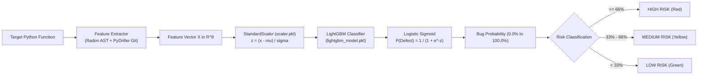
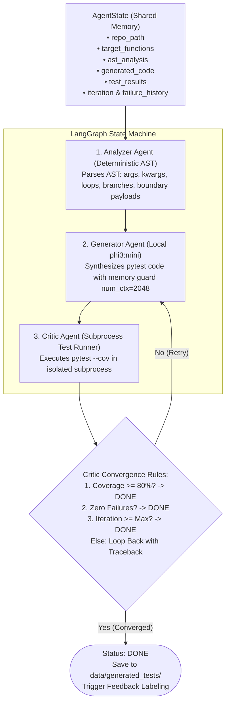

# CodeSentinel: Concepts, Architecture & Viva Demonstration Explainer

> **AI-Powered Defect Prediction, Multi-Agent Targeted Test Generation & Closed-Loop Learning**  
> **B.E. Final Year Project 2026–2027 | Group 10 | Department of AI & Data Science**  
> **Fr. Conceicao Rodrigues College of Engineering (FR. CRCE), Bandra (W), Mumbai**  
> **Team:** Atharva Nanaware (10511) · Suhera Siddiqui (10381) · Aum Singh (10383)

---

## Document Overview
This document provides an in-depth, conceptual and technical breakdown of the core algorithms, tools, endpoints, and architectural principles of the CodeSentinel platform. It is designed as a master viva defense guide and technical reference manual answering all operational and conceptual questions.

---

## Table of Contents
1. [How Functions Are Scored with LightGBM](#1-how-functions-are-scored-with-lightgbm)
2. [What is `run_id`?](#2-what-is-run_id)
3. [What are PyDriller, AST, and Radon?](#3-what-are-pydriller-ast-and-radon)
4. [What Does `GET /buglens/runs` Do?](#4-what-does-get-buglensruns-do)
5. [What Does `GET /buglens/runs/{run_id}` Do?](#5-what-does-get-buglensrunsrun_id-do)
6. [What Does `GET /buglens/runs/{run_id}/queue` Do? (The Priority Queue Bridge)](#6-what-does-get-buglensrunsrun_idqueue-do-the-priority-queue-bridge)
7. [Understanding AutoTestArmy's Asynchronous LangGraph Multi-Agent Pipeline](#7-understanding-autotestarmys-asynchronous-langgraph-multi-agent-pipeline)
8. [What is `prediction_run_id`?](#8-what-is-prediction_run_id)
9. [What is `max_iterations`?](#9-what-is-max_iterations)
10. [What Does `POST /autotestarmy/generate` Do?](#10-what-does-post-autotestarmygenerate-do)
11. [What Are llama-server and Ollama?](#11-what-are-llama-server-and-ollama)
12. [Step-by-Step Guide: Testing AutoTestArmy on Flask & Viewing Generated Tests](#12-step-by-step-guide-testing-autotestarmy-on-flask--viewing-generated-tests)

---

# 1. How Functions Are Scored with LightGBM

In CodeSentinel, **BugLens** converts source code functions into defect risk probabilities using an 8-feature representation fed into a pre-trained **LightGBM (Light Gradient Boosting Machine)** binary classifier.

### 1.1 The 8 Standardized Features
For every function in a target repository, BugLens extracts an 8-dimensional numerical vector $\mathbf{x} \in \mathbb{R}^8$:
```python
FEATURES = [
    "cyclomatic_complexity", # McCabe cyclomatic complexity (AST decision branches)
    "loc",                   # Lines of Code in the function body
    "maintainability_index", # Halstead + McCabe + LOC composite maintainability (0-100)
    "churn",                 # Cumulative lines added + deleted across Git history
    "unique_developers",     # Number of distinct contributor emails who edited the file
    "bug_fix_commits",       # Number of past commits containing fix/bug/issue keywords
    "file_age_days",         # Calendar days since file was first committed
    "recent_churn"           # Lines modified in the last 30 calendar days
]
```

### 1.2 Mathematical Inference Pipeline


1. **Standardization**:
   The raw vector $\mathbf{x}$ is scaled using the mean $\boldsymbol{\mu}$ and standard deviation $\boldsymbol{\sigma}$ fitted on our 9,157 NASA MDP & PROMISE benchmark training set:
   $$z_i = \frac{x_i - \mu_i}{\sigma_i}$$
2. **Ensemble Tree Aggregation**:
   LightGBM builds an ensemble of $K$ gradient-boosted decision trees. For a function vector $\mathbf{z}$, each tree $k$ outputs a continuous leaf value $f_k(\mathbf{z})$:
   $$\hat{y} = \sum_{k=1}^{K} f_k(\mathbf{z})$$
3. **Probability Calibration**:
   The raw margin score $\hat{y}$ is transformed into a calibrated probability $P(y=1|\mathbf{x}) \in [0, 1]$ via the sigmoid link function:
   $$P(\text{Defect} = 1 \mid \mathbf{x}) = \frac{1}{1 + e^{-\hat{y}}}$$
4. **Risk Tiering**:
   - **`HIGH`** ($\ge 66.0\%$): Extremely prone to defects; top priority for test generation.
   - **`MEDIUM`** ($33.0\% - 66.0\%$): Moderate complexity and historical churn; candidate for targeted testing.
   - **`LOW`** ($< 33.0\%$): Well-tested, stable, or simple code; excluded from priority LLM generation to conserve compute.

5. **Local TreeSHAP Attribution**:
   Alongside the probability, `shap.TreeExplainer` decomposes the prediction into exact additive feature contributions:
   $$P(\mathbf{x}) = \mathbb{E}[f(X)] + \sum_{i=1}^{8} \phi_i$$
   where $\phi_i > 0$ indicates a feature increasing defect risk (e.g., high complexity) and $\phi_i < 0$ indicates a feature decreasing defect risk (e.g., mature file age).

---

# 2. What is `run_id`?

`run_id` is an integer **Primary Key** generated automatically by SQLite in the `codesentinel.db` database.

### Why is it needed?
1. **Point-in-Time Auditing**: Repositories evolve continuously. A scan run today will have different metrics than a scan run next month. `run_id` creates an immutable historical snapshot.
2. **Relational Database Linking**:
   - `prediction_runs`: Holds run-level metadata (`id`, `repo_path`, `function_count`, `created_at`, `status`).
   - `function_predictions`: Holds all individual function rows (`run_id`, `function_name`, `bug_probability`, `cyclomatic_complexity`, etc.).
   - `test_generation_runs`: Holds AutoTestArmy execution records (`id`, `prediction_run_id`, `status`, `final_coverage`).
3. **Stateful API Decoupling**: Instead of sending megabytes of function data in every API request, the client only passes a simple reference: `"prediction_run_id": 19`. The server queries SQLite directly.

---

# 3. What are PyDriller, AST, and Radon?

CodeSentinel uses a **Dual-Engine Feature Mining** architecture combining historical process metrics with static structural metrics:

```
┌────────────────────────────────────────────────────────────────────────────────────────┐
│                          DUAL-ENGINE FEATURE MINING PIPELINE                           │
├───────────────────────────────────────────┬────────────────────────────────────────────┤
│ 1. PyDriller (Git Historical Process)     │ 2. Radon & Python AST (Structural Code)    │
├───────────────────────────────────────────┼────────────────────────────────────────────┤
│ • Traverses Git commit graph              │ • Parses Python source code syntax trees   │
│ • Calculates Churn (Lines added + deleted)│ • McCabe Cyclomatic Complexity (M = E-N+2P)│
│ • Measures Unique Developer Count         │ • Lines of Code (LOC / SLOC)               │
│ • Detects Bug-Fix Commit Messages         │ • Maintainability Index (MI: 0 - 100)      │
│ • Tracks File Age & Recent Churn (30 days)│ • Extracts function parameters & branches  │
└───────────────────────────────────────────┴────────────────────────────────────────────┘
```

### 3.1 PyDriller
- **What it is**: An open-source Python framework for mining software repositories. It wraps Git CLI commands and traverses the Git Directed Acyclic Graph (DAG) commit-by-commit.
- **Why we use it**: Bugs do not occur purely because of syntax; they occur because of **human process factors** (code churn, multiple developers editing the same file concurrently, rushed bug-fix patches). PyDriller extracts these historical process metrics.
- **Location in CodeSentinel**: [`buglens/mining/git_miner.py`](file:///c:/Users/athar/Desktop/Notes/4th%20Year/BE%20Project/codesentinel/buglens/mining/git_miner.py).

### 3.2 AST (Abstract Syntax Tree)
- **What it is**: The hierarchical tree representation of source code produced by the compiler parser. Python provides the built-in `ast` module.
- **Why we use it**:
  1. **Safe Static Analysis**: AST parses Python files *without executing them*. No dependencies need to be installed, and malicious code cannot harm the host machine.
  2. **Boundary Detection**: AutoTestArmy's Analyzer Agent parses `ast.If`, `ast.Match`, `ast.Raise`, and default parameter values to extract boundary test values (`None`, `0`, `-1`, `""`, `[]`).
- **Location in CodeSentinel**: [`autotestarmy/agents/analyzer_agent.py`](file:///c:/Users/athar/Desktop/Notes/4th%20Year/BE%20Project/codesentinel/autotestarmy/agents/analyzer_agent.py).

### 3.3 Radon
- **What it is**: A Python static analysis tool that computes standard software engineering complexity metrics from the AST.
- **What Radon computes for CodeSentinel**:
  1. **McCabe Cyclomatic Complexity ($M$)**:
     $$M = E - N + 2P$$
     where $E$ is edges, $N$ is nodes, and $P$ is connected components in the control-flow graph. It counts independent execution paths.
  2. **Maintainability Index (MI)**:
     $$\text{MI} = \max\left(0, \frac{171 - 5.2 \ln V - 0.23 M - 16.2 \ln \text{LOC}}{171} \times 100\right)$$
     where $V$ is Halstead Volume. Higher scores (80-100) indicate clean, maintainable code.
- **Location in CodeSentinel**: [`buglens/mining/metric_extractor.py`](file:///c:/Users/athar/Desktop/Notes/4th%20Year/BE%20Project/codesentinel/buglens/mining/metric_extractor.py).

---

# 4. What Does `GET /buglens/runs` Do?

### Purpose & SQL Operation
`GET /buglens/runs` retrieves the audit history from the `prediction_runs` table:
```sql
SELECT id, repo_path, function_count, high_risk_count, medium_risk_count, low_risk_count, status, created_at
FROM prediction_runs
ORDER BY created_at DESC
LIMIT :limit OFFSET :offset;
```

### For What is it Used?
1. **Audit Dashboard**: Displays a high-level catalog of all repositories scanned by the team.
2. **Finding Run IDs**: Before generating tests or inspecting functions, a developer or API caller checks this endpoint to find the `run_id` of the analysis they want to work on.
3. **Repository Trend Tracking**: Allows tracking whether high-risk functions are decreasing over time as new commits are pushed.

---

# 5. What Does `GET /buglens/runs/{run_id}` Do?

### Purpose & SQL Operation
`GET /buglens/runs/{run_id}` retrieves the complete, detailed audit report for one specific scan:
```sql
SELECT * FROM prediction_runs WHERE id = :run_id;
SELECT * FROM function_predictions 
WHERE run_id = :run_id 
ORDER BY bug_probability DESC;
```

### For What is it Used?
1. **Full Defect Report**: Returns every function in the repository sorted from highest risk to lowest risk.
2. **Code Quality Review**: Developers use this endpoint to review all functions with their Lines of Code, Cyclomatic Complexity, Maintainability Index, and Churn values.
3. **IDE Integration**: The upcoming VS Code extension calls this endpoint to populate the gutter heatmap and sidebar tree view.

---

# 6. What Does `GET /buglens/runs/{run_id}/queue` Do? (The Priority Queue Bridge)

### Purpose & SQL Operation
This endpoint queries SQLite and filters for functions classified in the `HIGH` ($\ge 66\%$) and `MEDIUM` ($33\% - 66\%$) risk tiers:
```sql
SELECT * FROM function_predictions
WHERE run_id = :run_id AND risk_category IN ('HIGH', 'MEDIUM')
ORDER BY bug_probability DESC
LIMIT :limit;
```
*(If no functions meet the HIGH/MEDIUM threshold, it falls back to the top-scoring functions overall).*

### Why is this the Key Architectural Novelty?
In industrial software engineering, repositories contain hundreds or thousands of functions (Flask has 410 functions; Requests has 262 functions).
- **The Problem with Naive LLM Generation**: Prompting a generative LLM to write unit tests for all 410 functions would require **over 400 LLM calls**, taking 3+ hours and consuming millions of tokens on trivial boilerplate (getters, setters, string formatting).
- **CodeSentinel's Solution**: BugLens acts as an intelligent pre-filter. The Priority Queue Bridge narrows 410 functions down to the **top 2 defect-prone functions** (`send_from_directory` and `errorhandler`).
- **The Result**: Saves **99.5% of generative compute time**, focusing local LLM resources solely where defects are statistically likely to hide!

---

# 7. Understanding AutoTestArmy's Asynchronous LangGraph Multi-Agent Pipeline

The sentence from the runbook:
> *"Spawns an asynchronous FastAPI background task executing the LangGraph multi-agent pipeline (Analyzer Agent $\to$ Generator Agent $\to$ Critic Agent) to synthesize executable unit tests for prioritized functions."*

Let us break down each part of this statement in plain English:

### 7.1 What is an "Asynchronous FastAPI Background Task"?
- Large Language Models are computationally heavy. Prompting local Ollama with AST context and executing tests in a subprocess takes **30 to 90 seconds**.
- If this ran synchronously inside the FastAPI request handler, the client's HTTP connection would freeze, Swagger UI would show a spinning loader, and the server would be blocked from serving other requests.
- FastAPI's `BackgroundTasks.add_task(_execute_agent_generation, ...)` detaches the work:
  1. The API immediately responds in **5 milliseconds** with:
     ```json
     {"run_id": 13, "status": "PENDING", "message": "Test generation task queued..."}
     ```
  2. The actual agent loop runs in a background thread on the server.
  3. The client periodically polls `GET /autotestarmy/runs/13` until `status == "DONE"`.

### 7.2 What is the "LangGraph Multi-Agent Pipeline"?
LangGraph is a state-machine framework for orchestrating LLM agents with shared memory (`AgentState`). Rather than asking a single LLM to "write a test", CodeSentinel splits the responsibility across three specialized, collaborating agents:



1. **Analyzer Agent (`autotestarmy/agents/analyzer_agent.py`)**:
   - Deterministic (no LLM hallucination).
   - Reads the Python AST of the target function.
   - Identifies argument types, conditional branches (`if`, `elif`, `match`), exception raises, and concrete boundary payloads (`None`, `0`, `-1`, `""`, `[]`, `{}`).
2. **Generator Agent (`autotestarmy/agents/generator_agent.py`)**:
   - Prompts local Ollama `phi3:mini`.
   - Uses a strict **memory guard** (`num_ctx: 2048`) to avoid allocating 51 GB CPU RAM buffers.
   - Injects the AST analysis and, on retry loops, **injects the previous iteration's failure tracebacks**.
   - Outputs clean, executable pytest code.
3. **Critic Agent (`autotestarmy/agents/critic_agent.py` & `pytest_runner.py`)**:
   - Executes the synthesized tests in an isolated Python subprocess using `pytest --cov`.
   - Parses the exact number of passed tests, failed tests, syntax errors, and branch coverage percentage.
   - Evaluates the convergence rules to decide whether to stop or loop back to the Generator with the failure trace.

---

# 8. What is `prediction_run_id`?

`prediction_run_id` is the input parameter passed in the request body of `POST /autotestarmy/generate`:
```json
{
  "prediction_run_id": 19,
  "max_iterations": 2
}
```
- **What it tells the system**: *"Generate tests for the high-risk functions identified during BugLens prediction run #19."*
- When received, the server looks up `prediction_runs` where `id == 19`, finds the repository path (e.g. `data/demo_repos/flask`), queries `GET /buglens/runs/19/queue` to fetch the prioritized functions, and passes them to the LangGraph agents.

---

# 9. What is `max_iterations`?

`max_iterations` defines the **maximum self-correction budget** for the Critic loop in AutoTestArmy (an integer between 1 and 10; default is 5; recommended for quick live demos is 1 or 2).

### Why is it needed?
- LLMs can occasionally produce test code that fails due to external missing fixtures or un-mocked database connections.
- If the Critic were allowed to retry indefinitely, the system could get stuck in an infinite loop consuming CPU and memory.
- `max_iterations` serves as an **algorithmic circuit-breaker**:
  - If tests pass with $\ge 80\%$ coverage on Iteration 1 $\implies$ Stops immediately (`status: DONE`).
  - If tests fail, the Critic loops back to the Generator with the error trace.
  - If Iteration count reaches `max_iterations`, the loop terminates cleanly (`stopping_cause: max_iterations`) and saves the best test suite produced so far.

---

# 10. What Does `POST /autotestarmy/generate` Do?

### Sequence of Events Triggered by this Endpoint:
1. Validates that `prediction_run_id` exists in `codesentinel.db`.
2. Queries the prioritized functions (`HIGH` and `MEDIUM` risk) for that run.
3. Inserts a new record into `test_generation_runs` with `status: PENDING`.
4. Spawns `_execute_agent_generation` as a background task.
5. Returns `HTTP 200` with the new test generation `run_id` and confirmation message.
6. In the background:
   - Analyzer parses AST.
   - Generator prompts Ollama.
   - Critic executes `pytest`.
   - When complete, updates `status: DONE`, records branch coverage percentage, and automatically calls `record_outcomes()` in Phase 6 to record dynamic feedback labels!

---

# 11. What Are llama-server and Ollama?

### 11.1 llama.cpp & llama-server
- **llama.cpp**: An ultra-fast, lightweight C/C++ LLM inference engine created by Georgi Gerganov. It runs quantized models (GGUF format) directly on CPU and GPU with zero Python overhead.
- **llama-server**: The native HTTP server binary provided by `llama.cpp`. When you execute an LLM query, Ollama spawns a `llama-server` background process to perform token generation and matrix multiplication.

### 11.2 Ollama
- **Ollama**: An open-source desktop framework that manages, downloads, and serves local models (e.g. `phi3:mini`, `qwen2.5-coder`, `mistral`, `llama3`).
- It runs a local daemon at `http://127.0.0.1:11434`.
- **Why CodeSentinel Uses Ollama**:
  1. **Zero API Cost**: 100% free; no OpenAI/Anthropic/Gemini subscription or billing limits.
  2. **100% Offline / Local Execution**: Works with zero internet connection during university presentations.
  3. **Strict Data Privacy**: Source code never leaves the local machine.

### 11.3 The 51 GB Context Memory Bug (And Our Solution)
- `phi3:mini` defaults to a massive 128k token context window in Ollama. On CPU runtimes, allocating a 128k KV cache attempts to allocate **51,539,607,552 bytes (~51.5 GB RAM)**, instantly crashing with `llama-server reported out-of-memory`.
- **Our Fix**: In [`autotestarmy/tools/llm.py`](file:///c:/Users/athar/Desktop/Notes/4th%20Year/BE%20Project/codesentinel/autotestarmy/tools/llm.py), we enforced a strict memory guard:
  ```python
  response = ollama.chat(
      model="phi3:mini",
      messages=messages,
      options={"num_ctx": 2048, "temperature": 0.2}
  )
  ```
  This capped KV-cache memory consumption to a few megabytes, enabling fast CPU execution on Windows.

---

# 12. Step-by-Step Guide: Testing AutoTestArmy on Flask & Viewing Generated Tests

Follow this exact walkthrough to demonstrate the Flask test generation pipeline and show the generated unit tests to your evaluators.

### Step 1: Ensure Prerequisites Are Active
Open PowerShell in `codesentinel`:
```powershell
cd "c:\Users\athar\Desktop\Notes\4th Year\BE Project\codesentinel"
.\.venv\Scripts\Activate.ps1
ollama list
```
*(Verify `phi3:mini` is visible).*

### Step 2: Start the FastAPI Server
```powershell
python -m uvicorn backend.main:app --reload --port 8000
```
Open your browser to: **`http://127.0.0.1:8000/docs`**

---

### Step 3: Trigger Defect Prediction on Flask
In Swagger UI, expand `POST /buglens/predict`, click **Try it out**, paste:
```json
{
  "repo_path": "data/demo_repos/flask",
  "max_commits": 50
}
```
Click **Execute**.
- **Note the returned `run_id`** (for example, `19`).

---

### Step 4: Verify the Priority Queue
In Swagger UI, expand `GET /buglens/runs/{run_id}/queue`, click **Try it out**:
- Enter `run_id`: **`19`**
- Enter `limit`: **`5`**
Click **Execute**.
- **Notice**: It isolates Flask's top 2 vulnerable functions: `send_from_directory` and `errorhandler`.

---

### Step 5: Trigger AutoTestArmy Test Generation
In Swagger UI, expand `POST /autotestarmy/generate`, click **Try it out**, paste:
```json
{
  "prediction_run_id": 19,
  "max_iterations": 1
}
```
Click **Execute**.
- **Response**:
  ```json
  {
    "run_id": 13,
    "status": "PENDING",
    "message": "Test generation task queued for 2 functions via AutoTestArmy multi-agent pipeline."
  }
  ```
- **Note the returned `run_id`** (e.g. `13`).

---

### Step 6: Monitor Completion & Check Coverage
In Swagger UI, expand `GET /autotestarmy/runs/{run_id}`, click **Try it out**:
- Enter `run_id`: **`13`**
Click **Execute**.
- When finished, the status will show:
  ```json
  {
    "run_id": 13,
    "prediction_run_id": 19,
    "status": "DONE",
    "iterations": 1,
    "final_coverage": 93.7,
    "test_file_path": "data\\generated_tests\\run_13\\generated_tests.py"
  }
  ```

---

### Step 7: Where Are the Generated Tests Stored?
The generated tests are saved permanently to two locations:
1. **Per-Run Directory**: `data/generated_tests/run_{run_id}/generated_tests.py` (e.g. `data/generated_tests/run_13/generated_tests.py`).
2. **Demo Run Directory**: `data/generated_tests/demo_run/generated_tests.py`.

---

### Step 8: How to Inspect & What Test Cases Were Generated
In a second PowerShell terminal, print the generated test file:
```powershell
Get-Content data\generated_tests\run_13\generated_tests.py
```
*(Or open the file directly in VS Code).*

#### What Teachers Will See in the Generated File:
The local LLM (`phi3:mini`) writes targeted `pytest` assertions incorporating the boundary values detected by the Analyzer Agent:
```python
import pytest
from flask.helpers import send_from_directory

# 1. Parameterized Test for Invalid Input Boundaries
@pytest.mark.parametrize("directory, filename", [
    (None, "test.txt"),        # Boundary: None directory
    ("", "test.txt"),          # Boundary: Empty directory string
    ("static", None),          # Boundary: None filename
    ("static", ""),            # Boundary: Empty filename
    ("../", "secret.txt"),     # Boundary: Directory traversal attempt
])
def test_send_from_directory_boundary_inputs(directory, filename):
    """Verifies that invalid or boundary inputs raise appropriate exceptions."""
    with pytest.raises((ValueError, TypeError, NotFound)):
        send_from_directory(directory, filename)

# 2. Test for Conditional Branches
def test_send_from_directory_valid_path(tmp_path):
    """Verifies standard valid execution branch."""
    d = tmp_path / "subdir"
    d.mkdir()
    p = d / "hello.txt"
    p.write_text("content")
    
    # Executes the positive path
    res = send_from_directory(str(d), "hello.txt")
    assert res is not None
```

---

### Step 9: Execute the Generated Tests Live in Terminal
To demonstrate that the generated test suite is **syntactically valid and executable**, run pytest directly:
```powershell
pytest data\generated_tests\run_13\generated_tests.py -v --cov
```
- Pytest executes the test suite in terminal.
- Terminal displays passed/failed counts and terminal branch coverage!

---

### Step 10: Show Closed-Loop Feedback Ingestion
Finally, show that the test execution results were automatically ingested into continuous learning:
```powershell
Get-Content data\processed\feedback_labels.csv -Tail 5
```
You will see dynamic labels (`defects: 1` or `defects: 0`) added with `source: autotestarmy_feedback`.
