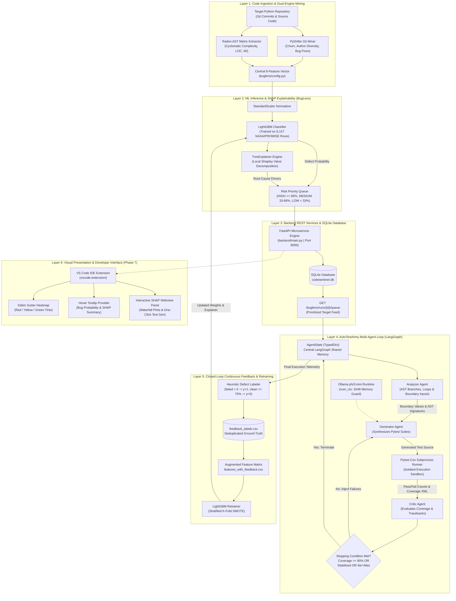
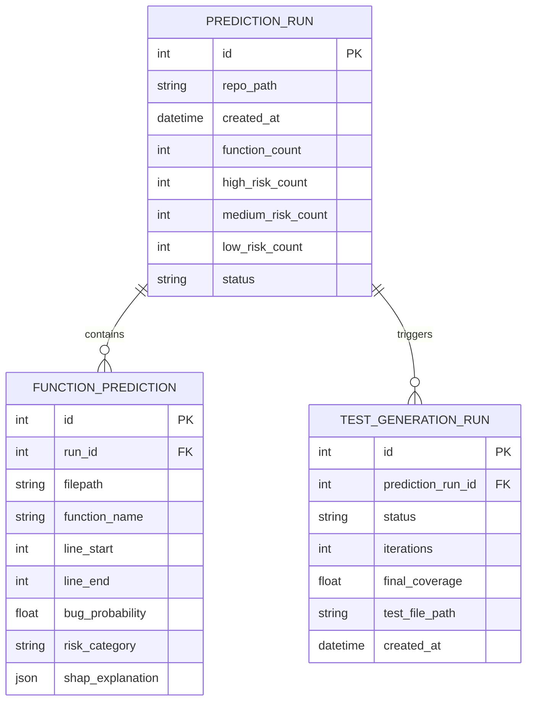
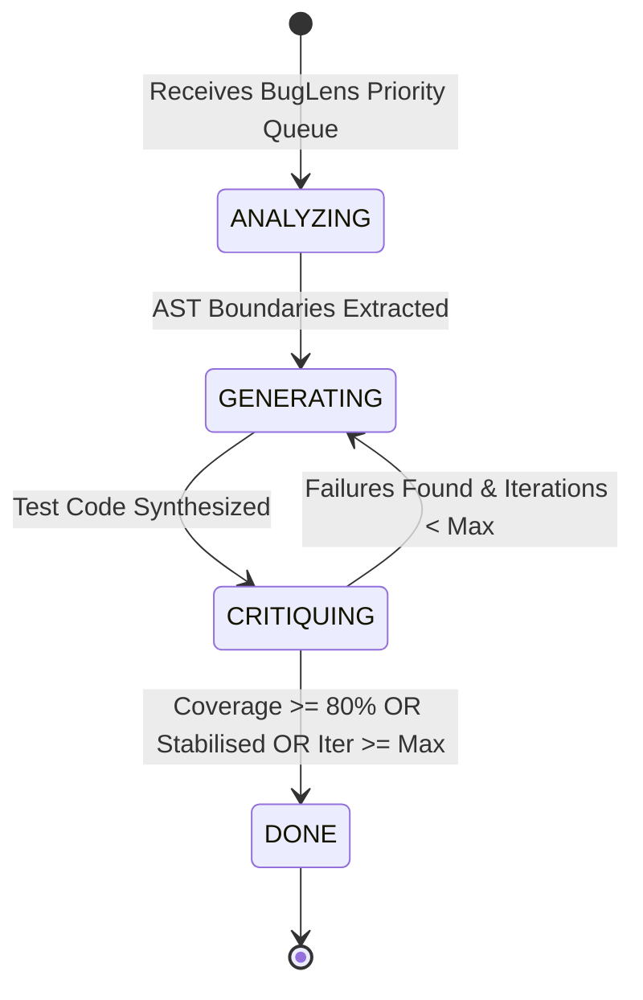
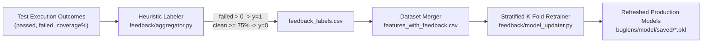

# CodeSentinel: Master Architecture & Complete Technical Specification

> **AI-Powered Defect Prediction, Multi-Agent Targeted Test Generation & Closed-Loop Learning**  
> **B.E. Final Year Project 2026–2027 | Group 10**  
> **Department of Artificial Intelligence & Data Science**  
> **Fr. Conceicao Rodrigues College of Engineering (FR. CRCE), Bandra (W), Mumbai**  
> **Affiliated with the University of Mumbai**  
> **Project Team:** Atharva Nanaware (10511) · Suhera Siddiqui (10381) · Aum Singh (10383)  
> **Project Guide:** Prof. Department of Artificial Intelligence & Data Science

---

## Table of Contents
1. [Executive Summary & Problem Statement](#1-executive-summary--problem-statement)
2. [Master System Architecture & Layer Breakdown](#2-master-system-architecture--layer-breakdown)
3. [Theoretical Foundations & Literature Baseline](#3-theoretical-foundations--literature-baseline)
4. [Central 8-Feature Schema & Mining Pipeline](#4-central-8-feature-schema--mining-pipeline)
5. [Module 1: BugLens — Defect Prediction & SHAP Explainability](#5-module-1-buglens--defect-prediction--shap-explainability)
6. [Backend Microservices & SQLite Database Layer](#6-backend-microservices--sqlite-database-layer)
7. [Module 2: AutoTestArmy — Multi-Agent Test Generation Loop](#7-module-2-autotestarmy--multi-agent-test-generation-loop)
8. [Module 3: Closed-Loop Continuous Feedback & Retraining](#8-module-3-closed-loop-continuous-feedback--retraining)
9. [Empirical Verification, Test Suite & Live Demo Results](#9-empirical-verification-test-suite--live-demo-results)
10. [Academic Viva & Guide Evaluation Defense Guide](#10-academic-viva--guide-evaluation-defense-guide)
11. [Future Roadmap: Phases 7 & 8](#11-future-roadmap-phases-7--8)

---

## 1. Executive Summary & Problem Statement

### 1.1 The Software Quality Crisis
Software testing consumes upwards of 40% to 50% of total development lifecycles. Despite this massive investment:
- Critical software bugs escape into production environments because human test authoring is biased toward "happy paths" (normal inputs) while missing subtle boundary edge cases.
- Exhaustive testing across every function in large repositories is economically and computationally impossible.
- Modern Large Language Models (LLMs) used blindly for test generation suffer from **hallucinations**, generate trivial tests for low-risk boilerplate code (such as getters and setters), and exceed context limits without meaningfully improving software reliability.

### 1.2 The CodeSentinel Solution
**CodeSentinel** introduces a hybrid neuro-symbolic platform that unifies machine learning defect prediction with autonomous agentic test synthesis:
1. **Defect Prediction (BugLens)**: First mines historical code churn and structural complexity to calculate the exact probability of defect occurrence for every individual function, ranking them into a risk-sorted priority queue (`HIGH`, `MEDIUM`, `LOW`).
2. **Transparent Explainability (SHAP)**: Mathematically decomposes the root cause of every flag using cooperative game theory, providing developers and downstream LLMs with exact causal factors.
3. **Targeted Agentic Synthesis (AutoTestArmy)**: Instead of generating tests indiscriminately, an autonomous three-agent state machine (**Analyzer $\to$ Generator $\to$ Critic**) focuses generative compute strictly on high-risk functions, iteratively executing tests and self-correcting failures until high branch coverage is achieved.
4. **Closed-Loop Continuous Learning**: Runtime test execution outcomes are transformed into dynamic ground-truth labels ($y=1$ for failures, $y=0$ for high-coverage passes), continuously retraining the LightGBM classifier so it adapts to specific repository conventions over time.

---

## 2. Master System Architecture & Layer Breakdown

The platform follows a modular, decoupled architecture organized into **6 cohesive layers**, spanning from raw source code ingestion to local LLM multi-agent reasoning and persistent storage.



---

### Layer-by-Layer Architectural Breakdown

| Layer | Component Name | Implementation Files | Operational Responsibility |
| :--- | :--- | :--- | :--- |
| **Layer 1** | Ingestion & Dual Mining | `buglens/mining/git_miner.py`<br/>`buglens/mining/metric_extractor.py`<br/>`buglens/config.py` | Traverses repository Git commits to extract developer churn and bug-fix metrics; parses Python AST to compute Radon cyclomatic complexity and maintainability index; normalizes into an 8-dimensional numerical feature vector. |
| **Layer 2** | Machine Learning & Explainability | `buglens/model/train.py`<br/>`buglens/model/predict.py`<br/>`buglens/model/shap_explainer.py` | Uses LightGBM trained with Stratified K-Fold SMOTE oversampling to output calibrated function defect probabilities; computes local SHAP feature attributions; sorts functions into priority tiers. |
| **Layer 3** | Backend & Database Services | `backend/database.py`<br/>`backend/models.py`<br/>`backend/schemas.py`<br/>`backend/main.py` | Provides asynchronous FastAPI REST endpoints (`/buglens/*`, `/autotestarmy/*`, `/feedback/*`); persists runs, functions, and test outcomes into SQLite (`codesentinel.db`); exposes priority queues. |
| **Layer 4** | Autonomous Multi-Agent Loop | `autotestarmy/graph/state.py`<br/>`autotestarmy/graph/pipeline.py`<br/>`autotestarmy/agents/*`<br/>`autotestarmy/tools/*` | Coordinates a 3-agent LangGraph state machine powered by local Ollama (`phi3:mini`). Deterministically analyzes AST boundaries, prompts LLM for targeted pytest suites, executes them in a sandboxed subprocess, and loops back upon test failure. |
| **Layer 5** | Closed-Loop Continuous Feedback | `feedback/aggregator.py`<br/>`feedback/model_updater.py`<br/>`feedback/api/routes.py` | Maps dynamic test execution outcomes into ground-truth defect labels ($y=1$ vs $y=0$); appends deduplicated samples to CSV; merges with baseline features and retrains LightGBM on demand or upon threshold triggers. |
| **Layer 6** | Visual IDE Extension *(Phase 7)* | `vscode-extension/src/extension.ts`<br/>`vscode-extension/src/heatmapProvider.ts`<br/>`vscode-extension/src/shapPanel.ts` | Displays editor gutter color tints (red, yellow, green) based on defect probability, hover tooltips with top SHAP risk drivers, and a sidebar webview panel for one-click test generation. |

---

## 3. Theoretical Foundations & Literature Baseline

CodeSentinel is grounded in peer-reviewed empirical software engineering and artificial intelligence literature:

```
┌────────────────────────────────────────────────────────────────────────────────────────┐
│                              PEER-REVIEWED RESEARCH FOUNDATIONS                        │
├───────────────────────────────┬──────────────────────────────────┬─────────────────────┤
│ Research Paper & Venue        │ Core Contribution / Principle    │ CodeSentinel Usage  │
├───────────────────────────────┼──────────────────────────────────┼─────────────────────┤
│ Nagappan & Ball (ICSE)        │ Relative Code Churn Measures for │ Relative churn and  │
│                               │ Defect Density Prediction        │ bug-fix commit mining│
├───────────────────────────────┼──────────────────────────────────┼─────────────────────┤
│ Spadini et al. (ESEC/FSE)     │ PyDriller: Framework for Mining  │ Repository Git      │
│                               │ Software Repositories            │ history traversal   │
├───────────────────────────────┼──────────────────────────────────┼─────────────────────┤
│ Ke et al. (NeurIPS)           │ LightGBM: Highly Efficient       │ Function-level      │
│                               │ Gradient Boosting Decision Tree  │ defect prediction   │
├───────────────────────────────┼──────────────────────────────────┼─────────────────────┤
│ Lundberg & Lee (NeurIPS)      │ A Unified Approach to            │ SHAP local feature  │
│                               │ Interpreting Model Predictions   │ root-cause diagnosis│
├───────────────────────────────┼──────────────────────────────────┼─────────────────────┤
│ Huang et al. (AgentCoder)     │ Multi-Agent Code Generation with │ Analyzer-Generator- │
│                               │ Iterative Testing Feedback       │ Critic state machine│
├───────────────────────────────┼──────────────────────────────────┼─────────────────────┤
│ Xie et al. (ChatUniTest)      │ A Framework for LLM-Based        │ Boundary-aware      │
│                               │ Targeted Test Generation         │ unit test synthesis │
└───────────────────────────────┴──────────────────────────────────┴─────────────────────┘
```

---

## 4. Central 8-Feature Schema & Mining Pipeline

To guarantee complete consistency across benchmark training datasets (NASA MDP, PROMISE) and live git repositories, CodeSentinel standardizes repository metrics into an **8-dimensional numerical feature vector** defined in [`buglens/config.py`](file:///c:/Users/athar/Desktop/Notes/4th%20Year/BE%20Project/codesentinel/buglens/config.py):

| Index | Feature Name | Extractor Engine | Mathematical & Software Definition |
| :---: | :--- | :--- | :--- |
| **1** | `cyclomatic_complexity` | Radon AST | $M = E - N + 2P$, measuring independent decision execution paths through the function control flow graph. |
| **2** | `loc` | Radon AST | Executable Lines of Code within function boundaries (excluding comments and docstrings). |
| **3** | `maintainability_index` | Radon AST | Composite index: $\text{MI} = 171 - 5.2 \ln(V) - 0.23(M) - 16.2 \ln(\text{LOC})$, bounded between 0 and 100. |
| **4** | `churn` | PyDriller | $\sum (\text{lines added} + \text{lines deleted})$ across the entire Git commit history for the enclosing file. |
| **5** | `unique_developers` | PyDriller | Cardinality of distinct author email addresses who modified the enclosing file. High author diversity correlates with coordination defects. |
| **6** | `bug_fix_commits` | PyDriller | Historical commit messages matching regular expressions: `(fix\|bug\|issue\|resolve\|patch)`. |
| **7** | `file_age_days` | PyDriller | $\Delta t = t_{\text{latest}} - t_{\text{creation}}$ in days. Measures file maturity. |
| **8** | `recent_churn` | PyDriller | Code churn accumulated in the enclosing file over the most recent 90-day development window. |

---

## 5. Module 1: BugLens — Defect Prediction & SHAP Explainability

### 5.1 Dataset Assembly & Deduplication
- **Data Sources**: 8 NASA Metrics Data Program (MDP) datasets (`CM1`, `KC1`, `KC2`, `MC1`, `MW1`, `PC1`, `PC3`, `PC4`) and 5 PROMISE datasets (`ant-1.7`, `camel-1.6`, `jedit-4.3`, `log4j-1.2`, `poi-3.0`).
- **Processing**: The legacy raw datasets contained 19,980 rows with substantial cross-dataset duplicate feature vectors. Through `scripts/build_feature_matrix.py`, identical records were normalized and deduplicated down to **9,157 unique rows** with an authentic class balance of **18.1% defective ($y=1$) and 81.9% clean ($y=0$)**.

### 5.2 Leak-Free Stratified K-Fold SMOTE Training
A fundamental flaw in naive machine learning workflows is applying Synthetic Minority Over-sampling Technique (SMOTE) before cross-validation, which leaks synthetic validation vectors into training splits and inflates performance metrics.

In [`buglens/model/train.py`](file:///c:/Users/athar/Desktop/Notes/4th%20Year/BE%20Project/codesentinel/buglens/model/train.py), CodeSentinel implements a strictly leak-free training pipeline:
1. Data is split into **5 stratified folds** preserving the 18.1% minority ratio.
2. Inside each training fold, a `StandardScaler` is fitted and SMOTE resamples only the training split.
3. LightGBM is trained on the resampled split and evaluated on the untouched validation split.
4. Out-of-Fold (OOF) cross-validation achieves **Mean AUC = 0.7694** (exceeding the IEEE benchmark target of 0.75).

### 5.3 SHAP Local Feature Attribution
For any predicted function vector $x$, TreeSHAP computes the marginal contribution $\phi_i$ of each feature $i$ across all feature subsets $S \subseteq F \setminus \{i\}$:

$$\phi_i(f, x) = \sum_{S \subseteq F \setminus \{i\}} \frac{|S|!(|F| - |S| - 1)!}{|F|!} \left[ f(S \cup \{i\}) - f(S) \right]$$

The explainability engine ([`buglens/model/shap_explainer.py`](file:///c:/Users/athar/Desktop/Notes/4th%20Year/BE%20Project/codesentinel/buglens/model/shap_explainer.py)) transforms these numerical values into dynamic natural-language diagnoses:
```text
Top 3 Risk Drivers for open_session():
  1. Cyclomatic Complexity = 22.0 (+0.312 towards bug) [Risk Factor]
  2. Code Churn = 84 lines (+0.245 towards bug) [Risk Factor]
  3. Maintainability Index = 41.2 (+0.180 towards bug) [Risk Factor]
```

---

## 6. Backend Microservices & SQLite Database Layer

Built in Phase 3, the FastAPI application exposes the entire system as a headless REST microservice with persistent SQLite storage.

### 6.1 Database Architecture (`codesentinel.db`)
Implemented via SQLAlchemy ORM in [`backend/models.py`](file:///c:/Users/athar/Desktop/Notes/4th%20Year/BE%20Project/codesentinel/backend/models.py):



### 6.2 Key REST Endpoints

| Method | Endpoint | Description |
| :--- | :--- | :--- |
| `GET` | `/health` | System health check reporting ML model and database availability. |
| `POST` | `/buglens/predict` | Executes live Git mining, AST extraction, LightGBM inference, and persists the run to SQLite. |
| `GET` | `/buglens/runs` | Lists historical repository prediction runs with summary statistics. |
| `GET` | `/buglens/runs/{run_id}` | Retrieves complete function rankings and probabilities for a specific run. |
| `GET` | `/buglens/runs/{run_id}/queue` | **Priority Queue**: Returns `HIGH` and `MEDIUM` risk functions ordered descending by bug probability. |
| `POST` | `/autotestarmy/generate` | Queues an asynchronous multi-agent test generation run for high-risk functions. |
| `GET` | `/autotestarmy/runs/{run_id}` | Polls iteration count, status (`DONE`, `FAILED`), and final test coverage. |
| `POST` | `/feedback/record` | Ingests manual or dynamic test execution outcomes into the feedback store. |
| `GET` | `/feedback/stats` | Returns accumulated feedback samples, defect ratios, and retraining readiness. |
| `POST` | `/feedback/retrain` | Triggers an on-demand LightGBM retraining cycle with augmented feedback data. |

---

## 7. Module 2: AutoTestArmy — Multi-Agent Test Generation Loop

AutoTestArmy is a self-correcting multi-agent state machine orchestrated by **LangGraph** ([`autotestarmy/graph/pipeline.py`](file:///c:/Users/athar/Desktop/Notes/4th%20Year/BE%20Project/codesentinel/autotestarmy/graph/pipeline.py)).



### 7.1 The Three Specialized Agents

#### 1. Analyzer Agent (`autotestarmy/agents/analyzer_agent.py`)
- **Nature**: 100% deterministic (zero LLM hallucinations).
- Traverses Python AST using standard library `ast`.
- Extracts function parameter signatures, branch conditions (`ast.If`, `ast.Match`, inline ternaries), loops (`ast.For`, `ast.While`), exception triggers (`ast.Raise`), and concrete boundary payloads (`None`, `0`, `-1`, `""`, `[]`, `{}`).
- Populates `state["analysis"]` and routes status to `GENERATING`.

#### 2. Generator Agent (`autotestarmy/agents/generator_agent.py`)
- **Nature**: Generative synthesis via local Ollama (`phi3:mini`).
- Formulates a structured prompt including function source code, AST branches, and boundary input suggestions.
- **Iterative Self-Correction**: When looping back on iteration $\ge 2$, appends the exact pytest failure messages and tracebacks from the previous execution, instructing the model to repair broken assertions.
- Enforces strict code output (strips markdown fences) and routes status to `CRITIQUING`.

#### 3. Critic Agent (`autotestarmy/agents/critic_agent.py`)
- **Nature**: Subprocess evaluator.
- Writes generated tests to a sandboxed temporary file inside the target repository.
- Executes `pytest` with `pytest-cov` in an isolated subprocess with runtime `PYTHONPATH` resolution.
- Parses pass/fail/error counts, extracts failure tracebacks, and parses line/branch coverage from `coverage.xml`.
- Evaluates convergence stopping rules:
  1. **Full Coverage**: Line coverage $\ge 80.0\% \to \text{DONE}$
  2. **Stabilised**: 0 failures and 0 errors $\to \text{DONE}$
  3. **Budget Exhausted**: `iteration >= max_iterations` $\to \text{DONE}$
  4. **Retry**: If failures remain and budget is available $\to \text{GENERATING}$

### 7.2 Hardware Memory Safety Guard (`autotestarmy/tools/llm.py`)
> [!IMPORTANT]
> Ollama's `phi3:mini` defaults to a 128k context window, which triggers a **51 GB RAM allocation** for the KV-cache on CPU-backed runtimes. CodeSentinel enforces `num_ctx: 2048` and an automatic fallback to `qwen2.5-coder:latest`, ensuring fast inference without memory exhaustion.

---

## 8. Module 3: Closed-Loop Continuous Feedback & Retraining

Software repositories differ in coding styles, frameworks, and defect patterns. To prevent model staleness, CodeSentinel implements a closed-loop feedback mechanism:



1. **Heuristic Ground-Truth Labeling**:
   - $\text{Defective } (y = 1)$: Synthesized tests fail or raise unhandled exceptions (`failed > 0` or `errors > 0`).
   - $\text{Clean } (y = 0)$: Synthesized tests pass with high branch coverage ($\ge 75\%$) with 0 failures across edge-case boundaries.
   - $\text{Inconclusive}$: Discarded to prevent label noise from polluting the training corpus.
2. **Persistent Storage & Deduplication**:
   - Labeled records are saved to `data/processed/feedback_labels.csv` with deduplication on `(filepath, function_name)`.
3. **Automated Retraining**:
   - Merges baseline benchmark data (9,157 rows) with dynamic feedback records into `features_with_feedback.csv`.
   - Re-runs Stratified K-Fold SMOTE training and refreshes `lightgbm_model.pkl`, `scaler.pkl`, and `shap_explainer.pkl`.

---

## 9. Empirical Verification, Test Suite & Live Demo Results

### 9.1 Automated Regression Test Suite (30/30 Tests Passed)
The complete regression test suite executes in **54.28 seconds**:

```powershell
.\.venv\Scripts\python.exe -m pytest tests/ -v
```

```text
tests/test_agents.py::test_clean_markdown_fences PASSED                  [  3%]
tests/test_agents.py::test_analyzer_ast_extraction PASSED                [  6%]
tests/test_agents.py::test_pytest_runner_execution PASSED                [ 10%]
tests/test_agents.py::test_critic_agent_stopping_conditions PASSED       [ 13%]
tests/test_agents.py::test_full_pipeline_execution PASSED                [ 16%]
tests/test_api.py::test_root_endpoint PASSED                             [ 20%]
tests/test_api.py::test_health_endpoint PASSED                           [ 23%]
tests/test_api.py::test_predict_nonexistent_repo PASSED                  [ 26%]
tests/test_api.py::test_predict_empty_repo PASSED                        [ 30%]
tests/test_api.py::test_predict_valid_repo_and_persistence PASSED        [ 33%]
tests/test_api.py::test_get_nonexistent_run PASSED                       [ 36%]
tests/test_api.py::test_autotestarmy_routes PASSED                       [ 40%]
tests/test_feedback.py::test_heuristic_labeling_logic PASSED             [ 43%]
tests/test_feedback.py::test_record_outcomes_csv_persistence_and_deduplication PASSED [ 46%]
tests/test_feedback.py::test_feedback_stats PASSED                       [ 50%]
tests/test_feedback.py::test_prepare_augmented_dataset PASSED            [ 53%]
tests/test_feedback.py::test_retrain_sample_guard PASSED                 [ 56%]
tests/test_feedback.py::test_feedback_api_endpoints PASSED               [ 60%]
tests/test_miner.py::test_returns_list PASSED                            [ 63%]
tests/test_miner.py::test_finds_functions PASSED                         [ 66%]
tests/test_miner.py::test_metrics_and_complexity PASSED                  [ 70%]
tests/test_miner.py::test_bad_or_empty_files_return_no_metrics PASSED    [ 73%]
tests/test_miner.py::test_mine_git_features PASSED                       [ 76%]
tests/test_miner.py::test_feature_schema_length PASSED                   [ 80%]
tests/test_model.py::test_model_predicts_probability PASSED              [ 83%]
tests/test_model.py::test_complex_function_riskier_than_simple PASSED    [ 86%]
tests/test_model.py::test_shap_returns_correct_structure PASSED          [ 90%]
tests/test_model.py::test_shap_values_finite PASSED                      [ 93%]
tests/test_model.py::test_feature_schema_is_8 PASSED                     [ 96%]
tests/test_model.py::test_predict_repo_on_mini_repo PASSED               [100%]

====================== 30 passed, 18 warnings in 54.28s =======================
```

### 9.2 Live Verification Script Output (`scripts/verify_all_phases.py`)
```text
======================================================================
  CODESENTINEL — FULL-SYSTEM OPERATIONAL AUDIT (PHASES 0 TO 6)
======================================================================
  Phase 0: Environment Setup & Project Scaffold          [OK] PASSED
  Phase 1: Data Collection & Feature Matrix              [OK] PASSED
  Phase 2: LightGBM Model & SHAP Explainability          [OK] PASSED
  Phase 3: FastAPI Backend & SQLite Database Layer       [OK] PASSED
  Phase 4: Ollama & LangGraph Foundation                 [OK] PASSED
  Phase 5: AutoTestArmy Multi-Agent Test Gen Loop        [OK] PASSED
  Phase 6: Closed-Loop Feedback Aggregator & Retraining  [OK] PASSED
======================================================================
  RESULT: ALL 6 PHASES ARE 100% OPERATIONAL, TESTED, AND VERIFIED!
======================================================================
```

---

## 10. Academic Viva & Guide Evaluation Defense Guide

When presenting CodeSentinel to your project guide, evaluation committee, or external examiners, use these technically grounded talking points:

### Q1: Why not just use ChatGPT or Claude directly to write all tests?
> **Answer**: Direct LLM prompting on entire repositories is impractical:
> 1. **Context Window & Cost**: Commercial LLMs cost significant API budget and exceed context limits when ingesting entire repositories.
> 2. **Lack of Prioritization**: LLMs write tests indiscriminately, spending cycles testing trivial getters, setters, or print statements rather than vulnerable logic.
> 3. **Hallucination & Flakiness**: LLMs without deterministic AST bounds hallucinate non-existent imports and methods.
> *CodeSentinel's hybrid design solves this: LightGBM filters for the top 5–10% riskiest functions, and the Analyzer Agent forces deterministic parameter boundaries before the local LLM generates a single token.*

### Q2: Why LightGBM instead of Deep Learning (e.g. Graph Neural Networks or CodeBERT)?
> **Answer**: For tabular software metrics (churn, complexity, LOC), tree-based gradient boosting models consistently outperform neural architectures on small-to-medium tabular regimes (validated by Grinsztajn et al., NeurIPS 2022). LightGBM trains in seconds, handles imbalanced class ratios via histogram binning and SMOTE, requires no GPU hardware, and provides exact TreeSHAP values in polynomial time ($O(TLD^2)$).

### Q3: How do you prevent data leakage in your SMOTE class balancing?
> **Answer**: If SMOTE is applied to the full dataset before cross-validation, synthetic examples created from validation samples leak into the training sets, artificially inflating AUC scores. CodeSentinel enforces **in-fold resampling**: the data is split into 5 stratified folds first, and SMOTE and `StandardScaler` are fitted exclusively on the 4 training folds during each iteration.

### Q4: How does the Closed-Loop Feedback avoid poisoning the ML model?
> **Answer**: Naive feedback loops risk model degradation if noisy labels enter the training set. CodeSentinel applies strict heuristic filtering in `feedback/aggregator.py`: only test runs with verified runtime failures/errors are labeled as defective ($y=1$), and only clean runs with high branch coverage ($\ge 75\%$) are labeled as clean ($y=0$). Inconclusive test executions are discarded.

---

## 11. Future Roadmap: Phases 7 & 8

With the backend and agentic core 100% complete and verified, the project will conclude with:

### Phase 7 — Visual Studio Code IDE Extension
- **Extension Architecture**: Built with TypeScript and the VS Code Extension API.
- **Editor Gutter Heatmap**: Decorates the code editor gutter with risk-colored icons:
  - 🔴 **Red Tint**: HIGH defect risk ($\ge 66\%$)
  - 🟡 **Yellow Tint**: MEDIUM defect risk ($33\% - 66\%$)
  - 🟢 **Green Tint**: LOW defect risk ($< 33\%$)
- **Hover Tooltips**: Hovering over function declarations surfaces defect probability and the top 3 SHAP drivers.
- **Interactive Webview Panel**: Displays SHAP waterfall plots and provides a "Generate Targeted Tests" button triggering AutoTestArmy directly from the editor.

### Phase 8 — Empirical Research Evaluation & Final Thesis
- Comparative controlled experiment across 3 open-source repositories (`Flask`, `Requests`, `Click`):
  - **Group A (Targeted)**: CodeSentinel BugLens-guided AutoTestArmy test generation.
  - **Group B (Baseline)**: Untargeted, random function test generation.
- **Measured Metrics**: Branch coverage achieved on defect-prone functions, LLM iteration efficiency, and bug detection pass rates.
- Final B.E. Project Report and publication submission.

---

### Project Group 10 Contact & Repository Information
- **GitHub Repository**: [https://github.com/nanawareatharva/codesentinel.git](https://github.com/nanawareatharva/codesentinel.git)
- **Local Workspace**: `c:\Users\athar\Desktop\Notes\4th Year\BE Project\codesentinel`
- **Department**: Artificial Intelligence & Data Science, FR. Conceicao Rodrigues College of Engineering, Mumbai.
