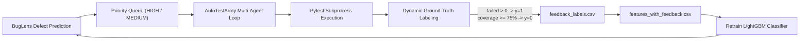

# CodeSentinel: AI-Powered Code Quality Platform

> **AI-Driven Defect Prediction, Targeted Multi-Agent Test Generation & Closed-Loop Learning**  
> **B.E. Final Year Project 2026–2027 | Group 10**  
> **Department of Artificial Intelligence & Data Science**  
> **Fr. Conceicao Rodrigues College of Engineering (FR. CRCE), Bandra (W), Mumbai**  
> **Team:** Atharva Nanaware (10511) · Suhera Siddiqui (10381) · Aum Singh (10383)

---

## 📌 Project Overview

**CodeSentinel** is an autonomous software engineering intelligence platform that solves the dual challenges of software defect risk detection and high-coverage unit test synthesis. Instead of generating untargeted, broad test suites, CodeSentinel accurately pinpoints vulnerable code paths and concentrates generative AI resources where defects are most likely to occur.

### The Three Core Engines (Phases 0 to 6 Completed):

1. **BugLens (Module 1 — Defect Prediction & Explainability)**:
   - Mines repository Git commit history (PyDriller) and AST code complexity metrics (Radon).
   - Predicts function-level defect probability using a **LightGBM** classifier trained on 9,157 benchmark samples (NASA MDP & PROMISE datasets) with Stratified K-Fold SMOTE resampling (**OOF AUC = 0.7694**).
   - Generates local feature attribution explanations using **SHAP (SHapley Additive exPlanations)**.
   - Organizes flagged functions into a risk priority queue (`HIGH`, `MEDIUM`, `LOW`).

2. **FastAPI & SQLite Layer (Backend & Persistence)**:
   - Headless REST microservice backend with CORS middleware and OpenAPI interactive documentation (`/docs`, `/redoc`).
   - SQLite database persistence (`codesentinel.db`) tracking historical prediction runs, function-level metrics, and test generation executions.
   - Priority queue endpoint (`GET /buglens/runs/{run_id}/queue`) feeding prioritized functions directly into generative agents.

3. **AutoTestArmy (Module 2 — Multi-Agent Test Synthesis Loop)**:
   - Multi-agent state machine orchestrated by **LangGraph** and powered locally by **Ollama (`phi3:mini` / `qwen2.5-coder`)** with zero cloud API dependencies.
   - **Analyzer Agent**: Deterministic AST parser extracting parameters, conditional branch lines (`ast.If`, `ast.Match`), loops, exceptions, and boundary inputs (`None`, `0`, `-1`, `""`, `[]`).
   - **Generator Agent**: Synthesizes clean, executable `pytest` test suites incorporating AST boundaries and past test failures.
   - **Critic Agent**: Subprocess test runner executing `pytest` with `pytest-cov`, parsing pass/fail/error counts, capturing tracebacks, and evaluating stopping conditions (Coverage $\ge 80\%$, stabilization, or max iterations).

4. **Closed-Loop Feedback Aggregator & Retraining (Module 3)**:
   - Dynamic ground-truth labeler: converts runtime test outcomes into confirmed defect labels ($y=1$ for persistent failures/errors, $y=0$ for high-coverage clean passes).
   - Automatically appends deduplicated samples to `data/processed/feedback_labels.csv`.
   - Augments baseline features and retrains the LightGBM classifier and SHAP explainer to continuously adapt to target codebases.

---

## 🚦 Project Phase Status

```
┌────────────────────────────────────────────────────────────────────────────────────────┐
│                                PROJECT IMPLEMENTATION STATUS                           │
├─────────┬──────────────────────────────────────────┬──────────────┬────────────────────┤
│ Phase   │ Name & Scope                             │ Status       │ Operational State  │
├─────────┼──────────────────────────────────────────┼──────────────┼────────────────────┤
│ Phase 0 │ Environment Setup & Project Scaffold     │ ✅ COMPLETED  │ Fully functional   │
│ Phase 1 │ Data Collection & Feature Engineering    │ ✅ COMPLETED  │ Fully functional   │
│ Phase 2 │ LightGBM Training & SHAP Explainability │ ✅ COMPLETED  │ Fully functional   │
│ Phase 3 │ FastAPI Backend & Database Layer         │ ✅ COMPLETED  │ Fully functional   │
│ Phase 4 │ Ollama Runtime & LangGraph State Schema  │ ✅ COMPLETED  │ Fully functional   │
│ Phase 5 │ AutoTestArmy Multi-Agent Test Gen Loop   │ ✅ COMPLETED  │ Fully functional   │
│ Phase 6 │ Closed-Loop Feedback Aggregator          │ ✅ COMPLETED  │ Fully functional   │
│ Phase 7 │ Visual Studio Code IDE Extension         │ ⏳ UPCOMING   │ Next Phase         │
│ Phase 8 │ Empirical Research Evaluation            │ ⏳ UPCOMING   │ Protocol designed  │
└─────────┴──────────────────────────────────────────┴──────────────┴────────────────────┘
```

---

## 📂 Repository Structure

```
codesentinel/
├── autotestarmy/                 # Module 2: Multi-Agent Test Generation
│   ├── agents/
│   │   ├── analyzer_agent.py     # Deterministic AST branch & boundary parser
│   │   ├── generator_agent.py    # Local LLM pytest synthesizer
│   │   └── critic_agent.py       # Coverage evaluator & convergence router
│   ├── api/
│   │   └── routes.py             # Background test generation REST endpoints
│   ├── graph/
│   │   ├── state.py              # Central LangGraph AgentState TypedDict
│   │   └── pipeline.py           # Compiled StateGraph (Analyzer -> Generator -> Critic)
│   └── tools/
│       ├── llm.py                # Ollama client with num_ctx=2048 memory guard
│       └── pytest_runner.py      # Subprocess pytest & pytest-cov execution engine
│
├── backend/                      # Phase 3: REST API & Persistence Layer
│   ├── database.py               # SQLite connection engine & get_db() session manager
│   ├── main.py                   # FastAPI application entrypoint with CORS & routes
│   ├── models.py                 # SQLAlchemy ORM models (PredictionRun, FunctionPrediction, etc.)
│   └── schemas.py                # Pydantic v2 validation & serialization schemas
│
├── buglens/                      # Module 1: Defect Prediction & Explainability
│   ├── config.py                 # Central 8-feature schema & model hyperparameters
│   ├── api/
│   │   └── routes.py             # BugLens prediction & priority queue REST endpoints
│   ├── mining/
│   │   ├── dataset_loader.py     # NASA MDP (.arff) & PROMISE (.csv) parser
│   │   ├── git_miner.py          # PyDriller engine (churn, authors, bug fixes)
│   │   └── metric_extractor.py   # Radon & AST engine (cyclomatic complexity, LOC, MI)
│   └── model/
│       ├── train.py              # Stratified K-Fold SMOTE LightGBM training pipeline
│       ├── predict.py            # Live repository inference engine
│       ├── shap_explainer.py     # Natural language SHAP root-cause explanations
│       └── saved/                # Production artifacts (lightgbm_model.pkl, etc.)
│
├── feedback/                     # Phase 6: Closed-Loop Continuous Learning
│   ├── aggregator.py             # Heuristic ground-truth defect labeler (y=1 vs y=0)
│   ├── model_updater.py          # Dataset augmentation & automated model retrainer
│   └── api/
│       └── routes.py             # Feedback recording & retraining REST endpoints
│
├── data/
│   ├── raw/                      # Downloaded NASA MDP & PROMISE benchmark datasets
│   ├── processed/                # Unified features.csv (9,157 rows)
│   ├── demo_repos/               # Cloned test repositories (Pallets Flask)
│   └── generated_tests/          # Preserved test suites synthesized by AutoTestArmy
│
├── scripts/
│   ├── download_datasets.py      # Auto-downloads all 13 defect prediction datasets
│   ├── build_feature_matrix.py   # Assembles 9,157-row training matrix
│   ├── demo_buglens.py           # Live interactive CLI inference & SHAP demo
│   └── verify_all_phases.py      # Automated 6-phase end-to-end system audit script
│
├── tests/                        # Automated Regression Test Suite (30 Tests)
│   ├── test_miner.py             # Unit tests for Git mining and AST extraction
│   ├── test_model.py             # Unit tests for LightGBM inference & SHAP
│   ├── test_api.py               # API & SQLite persistence integration tests
│   ├── test_agents.py            # Multi-agent AST, LLM, runner & graph tests
│   └── test_feedback.py          # Feedback labeling, CSV deduplication & retraining tests
│
├── codesentinel.db               # Local SQLite persistent database
├── requirements.txt              # Pinned production dependencies
├── requirements-dev.txt          # Development & test tooling
└── README.md
```

---

## ⚙️ Prerequisites & Setup

Ensure the following tools are installed:
- **Python**: **3.10, 3.11, or 3.12** *(Python 3.12 recommended)*.
- **Git**: Installed and available in system `PATH`.
- **Ollama**: Download from [ollama.com](https://ollama.com) and pull the local model:
  ```powershell
  ollama pull phi3:mini
  ```

### 1. Clone & Set Up Virtual Environment

```powershell
git clone https://github.com/nanawareatharva/codesentinel.git
cd codesentinel

python -m venv .venv
.\.venv\Scripts\Activate.ps1
```

### 2. Install Dependencies

```powershell
python -m pip install --upgrade pip
pip install -r requirements-dev.txt
```

---

## 🚀 How to Run & Experience CodeSentinel

### Option 1: Launch the Interactive FastAPI Web Dashboard (Swagger UI)

Start the local server:
```powershell
python -m uvicorn backend.main:app --reload --port 8000
```

Open your browser and navigate to:
👉 **[http://127.0.0.1:8000/docs](http://127.0.0.1:8000/docs)**

- **System Health**: Click `GET /health` $\to$ "Try it out" $\to$ "Execute" to confirm models are loaded.
- **Predict Defects**: Send a `POST /buglens/predict` request with `{"repo_path": "data/demo_repos/flask", "max_commits": 50}` to receive function-level defect probabilities and SHAP root-cause drivers.
- **View Priority Queue**: Query `GET /buglens/runs/1/queue` to inspect the prioritized test generation targets.
- **Generate Unit Tests**: Send `POST /autotestarmy/generate` with `{"prediction_run_id": 1, "max_iterations": 3}` to launch the autonomous multi-agent test synthesis loop.
- **Check Feedback Stats**: Query `GET /feedback/stats` to inspect accumulated ground-truth samples.

---

### Option 2: Run the Terminal CLI Demo on Flask

Run live defect prediction and SHAP analysis directly on the Pallets Flask framework:

```powershell
python scripts/demo_buglens.py data/demo_repos/flask
```

**Output Includes**:
- Live `tqdm` progress bar mining 500 Git commits and Radon AST metrics.
- Formatted risk priority queue table (`HIGH`, `MEDIUM`, `LOW`).
- Natural-language SHAP root-cause decomposition for the highest-risk functions.

---

### Option 3: Run the Full System Verification Audit

Execute the comprehensive verification script testing all 6 phases end-to-end:

```powershell
python scripts/verify_all_phases.py
```

---

### Option 4: Execute the Automated Regression Test Suite

Run all 30 automated tests across mining, modeling, REST APIs, multi-agent loops, and continuous feedback:

```powershell
pytest tests/ -v
```

**Measured Result**: `30 passed, 18 warnings in 54.28s (100% pass rate)`.

---

## 📊 Central 8-Feature Schema

CodeSentinel standardizes repository metrics into an 8-dimensional numerical feature vector:

| Feature Name | Extractor | Description |
|---|---|---|
| `cyclomatic_complexity` | Radon AST | Number of independent execution paths through the function |
| `loc` | Radon AST | Executable lines of code |
| `maintainability_index` | Radon AST | Composite maintainability score (0–100) |
| `churn` | PyDriller | Total lines added and deleted in the enclosing file |
| `unique_developers` | PyDriller | Number of distinct author emails modifying the enclosing file |
| `bug_fix_commits` | PyDriller | Historical commits matching bug-fix keywords in commit messages |
| `file_age_days` | PyDriller | Days elapsed between the file's first and latest commit |
| `recent_churn` | PyDriller | Lines modified in the enclosing file over the last 90 days |

---

## 🔁 Closed-Loop Feedback Cycle



---

## 👥 Contributors

- **Atharva Nanaware** (10511)
- **Suhera Siddiqui** (10381)
- **Aum Singh** (10383)

*Department of Artificial Intelligence & Data Science*  
*Fr. Conceicao Rodrigues College of Engineering (FR. CRCE), Bandra (W), Mumbai*
